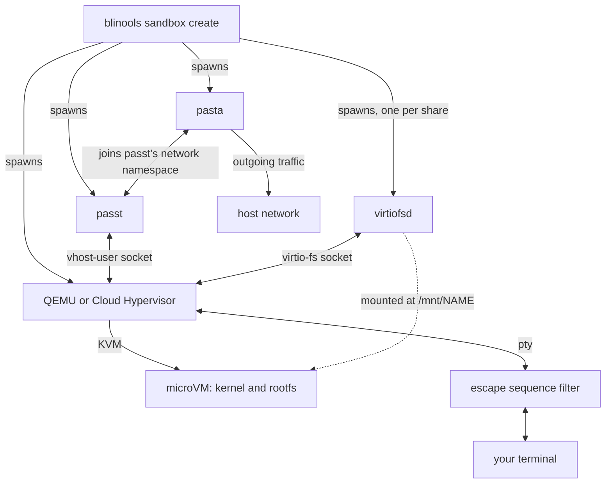

# Sandbox Architecture

This document describes how sandboxes are built.
For setup and usage, see the [sandbox guide](sandbox.md) and
for option values see the [configuration reference](configuration.md).

## Architecture

Each sandbox is a Linux microVM. `blinools sandbox create` starts the virtual
machine monitor (VMM) and helper processes, connects them over local Unix sockets,
and attaches the VM's console to your terminal through an escape sequence filter.

| Component | Role | Details |
| --- | --- | --- |
| VMM | Boots the guest using KVM and exposes a local control API | [Boot and storage](#boot-and-storage) |
| passt and pasta | Connect the guest to the host network | [Networking](#networking) |
| virtiofsd | Exposes one host directory per process | [Shares and file ownership](#shares-and-file-ownership) |
| Console filter | Relays terminal input and filters guest output | [Console and your terminal](#console-and-your-terminal) |

### Boot and storage

[QEMU](https://www.qemu.org/) (`qemu-system-x86_64`) is the default VMM.
[Cloud Hypervisor](https://github.com/cloud-hypervisor/cloud-hypervisor) is the alternative.
blinools controls them through a QEMU QMP socket or a Cloud Hypervisor API socket.

The VMM boots the configured `kernel` with a writable qcow2 overlay backed by
`rootfs`. The base image is read-only. The overlay is created on the first run
in the sandbox's [state directory](#on-disk-layout) and reused on subsequent boots.
It preserves writes to the guest root disk, not memory or running processes.
Writes to shared directories affect host files, writes to guest tmpfs are temporary.

The kernel command line starts with
`console=hvc0 root=/dev/vda rw systemd.hostname=<name>`, followed by `kernel_cmdline`
and any share mount instructions.
The configuration reference describes the [accepted kernel arguments](configuration.md#options).

### Console and your terminal

blinools allocates a pseudoterminal (pty), gives the hypervisor the slave side and
keeps the master. It filters problematic escape sequences from guest output before
forwarding it to your terminal emulator.

Keyboard signals such as `Ctrl-C` are passed to the guest.

### Process isolation

The VMM, passt and each virtiofsd process are created with `clone3`. Before executing
the binary, blinools sets up:

- Fresh **user, mount, network, PID, IPC, UTS and time namespaces**. The caller's
  UID and GID map to `0` in the user namespace, with `setgroups` disabled.
- A **private mount tree**: `/` is recursively private, and a fresh `/proc` is
  mounted with `nosuid,nodev,noexec`.
- A **new cgroup namespace**, which limits the process's view of the cgroup hierarchy.

pasta uses the same process launcher with namespace creation disabled. It needs
access to the host network and joins passt's network namespace to connect the two.

### Resource confinement

When cgroup setup succeeds, the VMM and helpers (passt, pasta and virtiofsd) start
directly in the sandbox cgroup using `CLONE_INTO_CGROUP`. cgroups v2 limits their
combined CPU usage to `cpus`, memory to `memory_mb` MiB plus 256 MiB of overhead,
and the number of tasks to 1024. Swap is disabled for the group.

This requires an existing
`/sys/fs/cgroup/user.slice/user-<uid>.slice/user@<uid>.service` and permission to
create a `blinools.slice` subgroup, enable its CPU, memory and PID controllers,
and write the limits. If setup fails, the sandbox continues without these cgroup
limits. The VMM still receives the configured guest CPU count and memory size.

### Networking

See [Network](configuration.md#network) for modes, DNS settings and exceptions.
With networking enabled, two programs cooperate:

1. [passt](https://passt.top) serves the guest NIC over a vhost-user socket from
   its own network namespace. Host port forwarding, ICMP, and host loopback and
   gateway mappings are disabled.
2. pasta starts in the host namespaces and attaches to passt's network namespace.
   It configures that namespace and forwards outgoing traffic to the host network.

Both programs currently run with `-4` (IPv4 only), using guest address
`10.200.0.2/24` and gateway `10.200.0.1`. The configured `dns` addresses are passed
to both programs. With `network.mode = "None"`, neither program is started and
the VMM receives no NIC.

In `Restricted` mode, blinools installs an nftables table (`ROOT_TABLE`, family
`inet`) **inside passt's network namespace**, after pasta configures networking
and before passt executes. `Unrestricted` mode skips the firewall.

| Chain | Policy | Rules, in evaluation order |
| --- | --- | --- |
| `input` | drop | Accept established and related connections |
| `forward` | drop | No rules, the namespace does not route packets |
| `output` | accept | Drop traffic to `lo`, accept configured DNS addresses on port 53, accept `network.exceptions`, drop `10.0.0.0/8`, `172.16.0.0/12`, `192.168.0.0/16`, `100.64.0.0/10` and `169.254.0.0/16`, drop `fc00::/7` and `fe80::/10` |

The first matching output rule wins. DNS and destination exceptions are evaluated
before the blocked address ranges and after the loopback-interface drop.
The rules include IPv6 address matches even though the current network setup is IPv4 only.

Each exception produces an accept rule for a network and, optionally, a destination
port. A single address becomes a `/32` or `/128` network. Hostnames are resolved
when the firewall is installed. Identical network-and-port entries are deduplicated.

### Shares and file ownership

[virtiofsd](https://gitlab.com/virtio-fs/virtiofsd) exposes each share's `host_dir`
over virtio-fs. Guest systemd processes the `systemd.mount-extra=` kernel arguments
to mount shares at `/mnt/NAME`. Other init systems need an explicit mount, see
[Shares](configuration.md#shares).

Operations on shared files use the host user's UID and GID. In the guest, host
files appear with `sandbox_user_uid` and `sandbox_user_gid` (both 1000 by default).

Access settings are implemented in virtiofsd's private mount namespace.
The host's normal view of the original files is unchanged:

- For a read-only share, `host_dir` is bind-mounted onto itself and remounted read-only.
- Otherwise, each `read_only_paths` entry is bind-mounted onto itself and remounted read-only.
- Each `hidden_paths` directory is covered with an empty, read-only tmpfs. Each file
  is covered with a read-only bind mount of an empty file.
  The paths remain visible in the guest, with their original contents masked.

The [command-line overrides](configuration.md#command-line-overrides) change these
settings for an individual run.

### Git integration

The [configuration reference](configuration.md#options) defines `git_action` and
[per-share overrides](configuration.md#shares).

Before virtiofsd serves a share, blinools walks its directory tree without following
symlinks and looks for `.git` entries. `ReadOnly` uses read-only bind mounts, `Hide`
uses the same empty-file or tmpfs mounts as `hidden_paths` and `None` skips this step.
The scan runs once, so `.git` entries created later are exposed according to the
share's normal access settings. The working tree remains writable unless the
share or relevant paths are read-only.

For a linked worktree, `.git` is a pointer file. blinools handles that file but does
not follow its target to protect or expose the metadata directory. If the target
is outside the shared directories, Git commands in the guest may fail because the
metadata is unavailable. If it is reachable through another share, its access is
determined by that share's settings and any `.git` entry found during its own scan.

### On-disk layout

| Path | Contents | Lifetime |
| --- | --- | --- |
| `$XDG_RUNTIME_DIR/blinools/<name>/` (or `/run/user/<uid>/blinools/<name>/`) | Hypervisor control socket, passt socket, pasta PID file, virtiofsd sockets and logs (`passt.log`, `pasta.log`, `vfsd-<share>.log`) | On normal shutdown, helpers cleanup removes sockets and the PID file. The directory and logs remain until deletion or pruning. |
| `$XDG_RUNTIME_DIR/blinools/<name>.lock` | Empty lock file used while an operation holds the sandbox lock | Removed when the holder exits normally, a crash can leave an unlocked file |
| `$XDG_STATE_HOME/blinools/<name>/` (or `~/.local/state/blinools/<name>/`) | qcow2 overlay storing changes to the guest root disk | Persists across boots, deletion or pruning removes it, and `--recreate` replaces it |

`--delete-after-shutdown` deletes the sandbox after the attached create command finishes.
